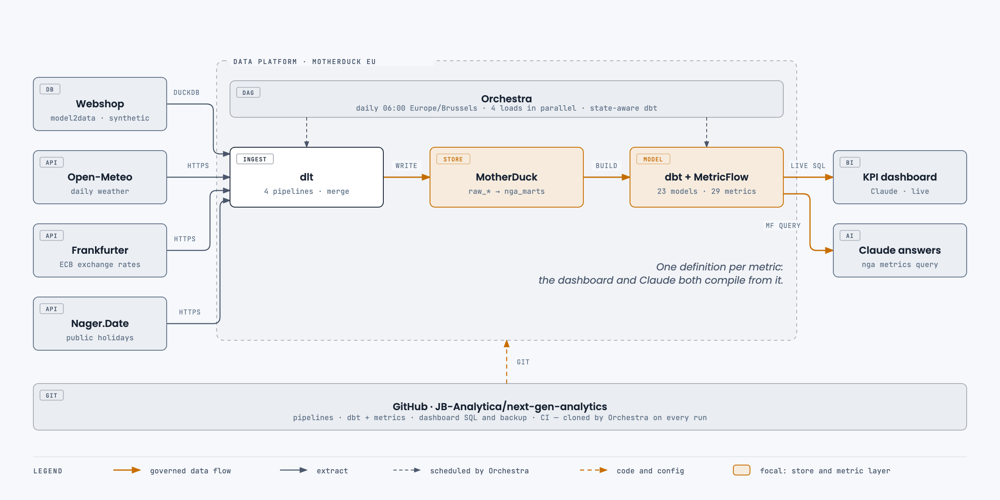
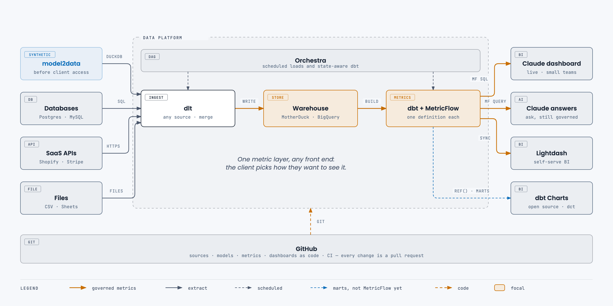
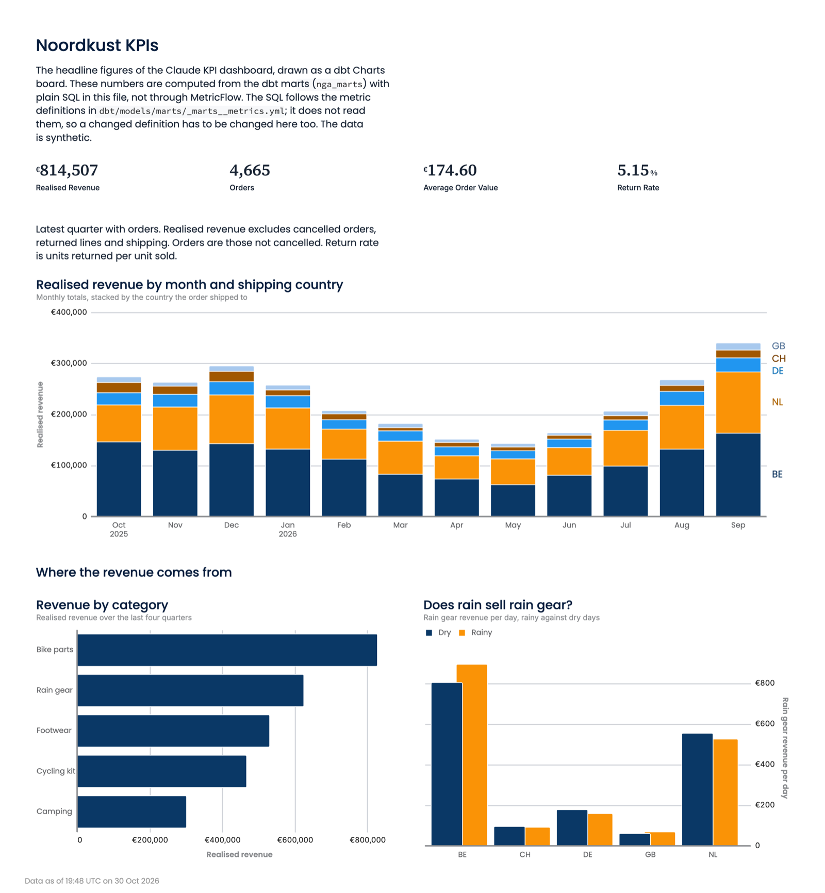

# next-gen-analytics

An analytics stack sized for a small company. dlt loads data into **MotherDuck**, dbt models it,
**MetricFlow** holds the single definition of every metric, and **Orchestra** runs it all once a
day. The front end is your choice: a live **Claude** dashboard, Claude answering questions,
**Lightdash** or **dbt Charts**, all reading the same metric layer.



## Why this exists

A five-person company rarely needs a BI server, a BI licence and someone to run them. What it
does need is numbers it can trust: the same revenue figure in the dashboard, in a chat answer and
in next quarter's board deck. This repository shows one way to get that cheaply:

- **One place where metrics are defined.** Revenue, order counts and return rate live in dbt
  YAML as MetricFlow metrics. Every front end either reads those definitions or is checked
  against them.
- **No servers to run.** MotherDuck hosts the warehouse, Orchestra schedules the jobs, and Claude
  or a static HTML file is the front end.
- **Almost nothing to pay for infrastructure.** At this data size the warehouse and the scheduler
  both fit their vendors' free or entry tiers. Check the current limits yourself; MotherDuck's
  free plan, for example, caps the number of users. The real recurring cost is the Claude seats
  of whoever uses the dashboard.
- **Front ends you can swap.** Because the metric layer is the product, swapping the front end
  later means a new client, not a migration.

**The business** is Noordkust Outdoor, a made-up Benelux webshop for rain gear, cycling and
camping kit that also ships to Germany, Great Britain and Switzerland. Its operational data is
synthetic: [model2data](https://github.com/JB-Analytica/model2data) generates it from
[`source_system/noordkust.dbml`](source_system/noordkust.dbml), pinned to an as-of date of
1 October 2026. Real weather ([Open-Meteo](https://open-meteo.com)), ECB exchange rates
([Frankfurter](https://frankfurter.dev)) and public holidays ([Nager.Date](https://date.nager.at))
come from three public APIs that need no key. That means a question such as "do rainy days sell
rain gear?" is answered with real weather.

## How the numbers stay consistent

Metrics are defined once, in
[`dbt/models/marts/_marts__metrics.yml`](dbt/models/marts/_marts__metrics.yml): 6 semantic
models and 29 metrics. Nothing else computes them:

- **Claude answers** data questions in this repo through `nga metrics query`, following the
  [`answering-with-metricflow`](.claude/skills/answering-with-metricflow/SKILL.md) skill. SQL
  written on the spot is a last resort, and it is labelled as such.
- **The Claude dashboard** queries MotherDuck live through Claude's MotherDuck connector. Each
  chart runs the SQL that MetricFlow compiled for its metrics, kept in
  [`dashboard/queries/`](dashboard/queries/). A test fails if the dashboard backup and the
  compiled SQL drift apart. After Orchestra's morning run, opening the dashboard shows the new
  numbers.

## Choose a front end



All four front ends run on the same dbt project and the same MotherDuck database:

| Front end | Reads | Fits | Status here | Guide |
|---|---|---|---|---|
| **Claude dashboard** | SQL compiled by MetricFlow, live on Claude's MotherDuck connector | a small team that already uses Claude | running | [`dashboard/README.md`](dashboard/README.md) |
| **Claude answers** | `nga metrics query` (MetricFlow) | ad-hoc questions with governed answers | running | [the skill](.claude/skills/answering-with-metricflow/SKILL.md) |
| **Lightdash** | MetricFlow metrics, translated on deploy (all 29 here) | self-serve BI: any dimension on any metric | compiles offline; deploying needs a Lightdash project | [`docs/lightdash.md`](docs/lightdash.md) |
| **dbt Charts** | the marts through `ref()`, not MetricFlow (yet) | static, branded boards with no account and no server | renders locally | [`docs/dbt-charts.md`](docs/dbt-charts.md) |

### What the dbt Charts board looks like

[`charts/noordkust_kpis.yml`](charts/noordkust_kpis.yml), rendered from the local warehouse with
`dct render`. It's one self-contained HTML file, with no server and no account:



## Known limits

- **dbt Charts repeats the metric logic.** It has no Semantic Layer connection, so the board
  computes its figures with its own SQL over the marts. Today they match the Claude dashboard to
  the euro, but a changed metric definition has to be changed in the board too. dbt Charts also
  can't open a `md:` MotherDuck path, so against the hosted warehouse it renders from a
  read-only local copy.
- **Lightdash translates MetricFlow metrics with rules.** All 29 metrics here translate. That
  works because each metric's filter only uses dimensions of its own semantic model. Lightdash's
  translator skips a filter that reaches into another semantic model, as well as `cumulative`
  and `conversion` metrics, offset windows and a few other features. Keep new metrics inside
  those rules, and check `lightdash compile --verbose` for skips. Its
  [MetricFlow page](https://docs.lightdash.com/references/integrations/dbt-metricflow) lists them.
- **Dashboard viewers need their own MotherDuck access.** The Claude dashboard's live queries
  run with each viewer's MotherDuck connection, so everyone it is shared with needs read access
  to `next_gen_analytics`.
- **Synthetic shop data.** The webshop's figures are generated, so trends in them are designed,
  not discovered. Only the weather, exchange rates and holidays are real.

## What you need first

- [`uv`](https://docs.astral.sh/uv/). Everything runs locally with no account:
  `NGA_DESTINATION=duckdb` writes to `warehouse/nga.duckdb`.
- For the hosted stack:
  - a [MotherDuck](https://motherduck.com) token in `.env` (see `.env.example`);
  - an [Orchestra](https://www.getorchestra.io) account, set up as described in [`docs/orchestra.md`](docs/orchestra.md);
  - Claude with the MotherDuck connector, for the dashboard.

## Quick start

```bash
uv sync --extra dev
NGA_DESTINATION=duckdb uv run nga run          # generate → load → dbt build, about a minute
NGA_DESTINATION=duckdb uv run nga metrics query --metrics realised_revenue_eur --group-by metric_time__quarter
```

A clean run produces these results:

- dlt loads 5 shop tables, 1,830 weather days, about 512 FX rates and 162 holidays.
- dbt reports `PASS=121`: 23 models, 96 data tests and 2 unit tests.
- Q4 2025 realised revenue comes out at €831,611.

## Working on it

| Command | What it does |
|---|---|
| `uv run nga generate` | rebuild the synthetic source (deterministic) |
| `uv run nga load [shop\|weather\|fx\|holidays\|all]` | dlt into the `raw_*` schemas |
| `uv run nga transform <dbt args>` | dbt with the repo's profile (default `build`) |
| `uv run nga metrics <mf args>` | MetricFlow, after a `dbt parse` against the same warehouse |
| `uv run nga dashboard-sql` | compile the dashboard's queries into `dashboard/queries/` |
| `uv run poe check` | ruff + ty + pytest |

Prefix a command with `DBT_TARGET=prod` to read or build the production schemas on MotherDuck
(`nga_*`). Without it, dbt and MetricFlow use dev (`nga_dev_*`).

**To change a metric the dashboard uses:**

1. Edit the dbt YAML.
2. Run `DBT_TARGET=prod uv run nga dashboard-sql`.
3. Commit the changed SQL.
4. Ask Claude to put the new query into the dashboard. It sets that file's SQL, unchanged, as the chart's live query.

## Layout

- [`source_system/`](source_system/) holds the DBML, the only description of the shop. The data generated from it is git-ignored.
- [`nga/`](nga/) holds the config, the model2data wrapper (`generate.py`), the dlt pipelines, the dashboard query compiler (`dashboard.py`) and the CLI.
- [`dbt/`](dbt/) holds the models, the MetricFlow semantic models and metrics in `models/marts/`, the checked-in `profiles.yml`, and the `requirements.txt` that Orchestra's dbt task installs.
- [`dashboard/`](dashboard/) holds the Claude dashboard's live SQL (`queries/`, generated by `nga dashboard-sql`) and a backup of the dashboard itself (`artifact/`).
- [`charts/`](charts/) holds the dbt Charts board, its brand theme and the Poppins fonts it embeds.
- [`lightdash/`](lightdash/) holds the Lightdash dashboard blueprint.
- [`.claude/skills/`](.claude/skills/) holds how Claude answers data questions in this repo.
- [`docs/`](docs/) holds:
  - the architecture diagrams in `architecture/`, generated by `build.py` (`python3 docs/architecture/build.py --export`);
  - the Orchestra, Lightdash and dbt Charts guides;
  - the version pins.

## Licence

MIT, see [`LICENSE`](LICENSE). The Poppins font files in `charts/fonts/` are under the SIL Open
Font License 1.1 ([`charts/fonts/OFL.txt`](charts/fonts/OFL.txt)).
